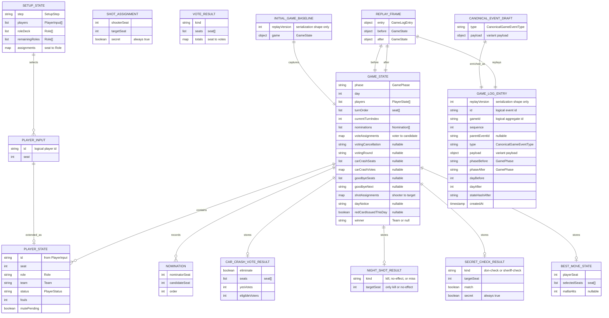

# Entity model

This document describes the supported Azure persistence model and the core game-domain model. It is derived from:

- [`packages/game-domain/src/types.ts`](../packages/game-domain/src/types.ts) for game state;
- [`packages/game-domain/src/game-events.ts`](../packages/game-domain/src/game-events.ts) for canonical events and replay metadata;
- [`apps/server/src/azure-storage.ts`](../apps/server/src/azure-storage.ts), [`azure-game-session-store.ts`](../apps/server/src/azure-game-session-store.ts), [`azure-club-player-store.ts`](../apps/server/src/azure-club-player-store.ts) and [`azure-account-store.ts`](../apps/server/src/azure-account-store.ts) for persistence.

The diagrams are conceptual excerpts, not exhaustive TypeScript declarations; their relationships describe containment, extension, or event payloads rather than database foreign keys. `o|`, `||`, and `o{` mean zero-or-one, exactly one, and zero-or-many respectively. The obsolete PostgreSQL physical diagram is removed with that backend. Its retirement does not convert or erase existing data; the separately gated one-time Azure normalization is described below.

## Azure logical entities

These are logical RowKey families in one physical table and application partition, not independent tables or SQL foreign keys. Club-prefixed keys constrain lookup scope; server authorization is still required. [IDD-0006](../.idd/intent/IDD-0006.adr-azure-table-and-blob-persistence.md) records the decision and tradeoffs.

| Family                                                         | Contents / relationship                                                                                                                                 |
| -------------------------------------------------------------- | ------------------------------------------------------------------------------------------------------------------------------------------------------- |
| `control`                                                      | Schema version, persisted dataset identity, write mode and conditional commit revision; included in every structured mutation.                          |
| `commit:<attempt>`                                             | Exact atomic publication receipt, also included in the mutation; it proves an ambiguous commit even after a later writer.                               |
| `user:<id>`, `subject:<digest>`, `email:<digest>`              | Account profile plus unique provider/exact-email reservations; verified normalized email matching remains separate.                                     |
| `session:<token-digest>`                                       | Hashed application token, user identity and expiry; no clear session token.                                                                             |
| `music:<userId>`                                               | Existing encrypted music token material, expiry, scope and account label.                                                                               |
| `club:<clubId>:meta`, `member:<userId>`                        | Settings/owner and club-local membership/access-player link; oversized logo values use private blob references.                                         |
| `club:<clubId>:player:<id>`, `nickname:<digest>`               | Permanent club-scoped identity, erasable consenting profile and normalized nickname reservation. Retired profiles retain only their anonymous identity. |
| `club:<clubId>:game:<gameId>`                                  | Bounded catalog head, revision/status and the selected immutable envelope blob's name, length and transport checksum; no rules-engine identity.         |
| `club:<clubId>:creation:<creationId>`                          | Original creation request to server-issued game identity; retained after game deletion.                                                                 |
| `club:<clubId>:participant:<gameId>:<playerId>`                | Bounded selected host/seat projection; not a reconstruction of the authoritative setup.                                                                 |
| `club:<clubId>:result:<gameId>:<playerId>`                     | Bounded noncancelled player/host result projection; statistics scan result families once.                                                               |
| `club:<clubId>:deleted-game:<gameId>`, `deleted-club:<clubId>` | Non-resurrection and resumable purge markers.                                                                                                           |
| `cleanup:<digest>`                                             | Retired immutable blob reference awaiting separately scoped cleanup.                                                                                    |

The game envelope is a private, create-only JSON blob. For active games it preserves the full accepted setup/state, including empty seats, role draw, playlist, canonical baseline/history and Undo fields. For completed games it preserves independently known results/observations and any faithful optional timeline detail; a full snapshot or playable replay is not a prerequisite for factual validity. There is no Table entity per canonical event. Free-text reasons and variable meaningful fields stay in the envelope; bounded summaries may read the authoritative blob rather than truncate or reject an accepted value.

Every game retains club/game identity, ownership, active/completed status, revision and publication relationships. Known label, played time, host, tournament, outcome/reason/adjudication, participant identity and independently known seat, role/team, final status, fouls, Best Move and actual Casper/roster facts survive without invented defaults. Absence is unknown, not zero, false, loss or a synthetic timestamp. Derived statistics use only inputs relevant to each metric; Elo requires its actual complete inputs but not unrelated foul/status/timeline observations. Unfiltered history keeps partial records; filters requiring an unknown value cannot match it.

No persisted business object contains `rulesEdition`, `rulesetId`, `rulesetVersion` or an equivalent engine selector. Schema/replay serialization versions, revisions, dataset identity, checksums, recovery metadata and the Elo algorithm identifier do not select alternative rules. Names in views are resolved from club-scoped opaque player references; persisted game/player/event identities and their established UUID comparison behavior are preserved.

Blob bytes are verified before the conditional transaction publishes the head and synchronized projections. The stored SHA-256 is a transport-integrity checksum, not a new canonical replay hash. A selected missing/corrupt blob is an error; no older revision or empty snapshot is substituted. Typed Table scalars/dates/binary values omit SQL-style nulls via full replacement. Relationships, uniqueness, consent and active-identity admission are enforced under the same conditional control boundary, not through Azure foreign keys.

## Core game-domain entities

These entities are framework-independent TypeScript values. They are not additional SQL tables, and their identifiers are logical game/player/event identifiers rather than independent database constraints.

`Role`, `Team`, `SetupStep`, `PlayerStatus`, `GamePhase`, and `Winner` are discriminated scalar unions, so they appear as field types rather than fake entities. `votingCancellation` and `votingRound` are inline optional state variants. `VoteResult` and `ShotAssignment` are canonical event payload values; they are connected to their event variants below rather than stored directly in `GameState`.

## Canonical game events

A `CanonicalGameEventDraft` has exactly one variant. The diagram below illustrates core event families, not the exhaustive current union: accepted ballot reviews, support corrections, Best Move prefixes, physical-shot observations, discipline/adjudication and draw/cancellation facts also follow current domain declarations. Mermaid ER has no XOR connector, so optional variant edges mean alternatives, not independently optional children. No event carries an engine selector.

| Event type                  | Payload                                                           | Visibility |
| --------------------------- | ----------------------------------------------------------------- | ---------- |
| `game.started`              | Empty                                                             | Secret     |
| `game.checkpointed`         | Empty                                                             | Secret     |
| `phase.changed`             | Destination phase                                                 | Public     |
| `turn.completed`            | Seat                                                              | Public     |
| `player.nominated`          | Nominator and candidate seats                                     | Public     |
| `foul.issued`               | Seat, foul number, red-card flag, and optional discipline context | Public     |
| `player.red-carded`         | Seat and optional discipline context                              | Public     |
| `voting.skipped`            | Host-skipped reason                                               | Public     |
| `voting.resolved`           | Vote assignments and `VoteResult`                                 | Public     |
| `car-crash.resolved`        | Votes and `CarCrashVoteResult`                                    | Public     |
| `car-crash.ballot-resolved` | Votes and `CarCrashVoteResult`                                    | Public     |
| `mafia.shots-resolved`      | Secret shot assignments and `NightShotResult`                     | Secret     |
| `don.checked`               | Target seat and match result                                      | Secret     |
| `don.check-skipped`         | Empty                                                             | Secret     |
| `sheriff.checked`           | Target seat and match result                                      | Secret     |
| `sheriff.check-skipped`     | Empty                                                             | Secret     |
| `best-move.completed`       | Player seat, selected seats, and Mafia hit count                  | Secret     |
| `game.completed`            | Winning team                                                      | Public     |

Provisional individual vote assignment/removal, candidate selection, collective-lift votes and shot assignments live in the authoritative active snapshot until accepted. Accepted host decisions and physical-shot observations retain their canonical facts and privacy; timer/music activity remains local auxiliary state. Setup activity is distinct from canonical gameplay, not an older-format reconstruction path.

## Persistence-to-domain mapping

| Persisted material                              | Domain meaning                                                                                                                                                                                               |
| ----------------------------------------------- | ------------------------------------------------------------------------------------------------------------------------------------------------------------------------------------------------------------ |
| Game head plus private envelope `session.state` | Authoritative full active browser snapshot, including setup/current game, canonical baseline/history and Undo allowance. Completed detail may be absent. The selected immutable Blob is verified before use. |
| Envelope `session.results`                      | Independently known accepted terminal facts, including partial observations, with synchronized club-local projections for queries/statistics; no replay-based winner recomputation.                          |
| Envelope `events`                               | Optional retained completed timeline or active canonical prefix, preserving type/payload, linkage and hashes. Secret event projection remains server-side and authenticated.                                 |
| Creation mappings and deletion markers          | Original creation retries remain bound to the same server-issued identity; deleted games cannot be recreated by stale saves/retries.                                                                         |
| Optional envelope provenance                    | Existing source-only metadata remains preserved outside public/canonical state; it does not restore SQL support or an import path.                                                                           |

Azure preserves the last accepted current active snapshot and exact semantic event prefix. Domain replay follows the retained parent chain to validate phase/day transitions, lifecycle and canonical hashes for Log/Timeline integrity, but the snapshot's `state.game` remains live authority. Completed facts remain usable independently of optional replay; absent detail is unavailable, not an invalid game, while corrupt retained canonical authority cannot enable fallback play. The field named `legacyLog` still carries current setup/activity entries; its name alone is neither an engine selector nor deletion authority.

[IDD-0005](../.idd/intent/IDD-0005.spec-data-compatibility-and-preservation.md) permits only an explicitly invoked one-time Azure representation conversion outside normal runtime. Preserve every game, known fact and valid relationship; retain faithfully convertible timelines or record a completed statistics-only disposition, never discard incompatible active/unsent state. Corresponding hashes may change only for verified explicit representation conversion, not ordinary saves, profile resolution or tournament edits. Any predecessor decoder stays in private local operational material. Exact-target inventory, separately authorized writes, proven backup/recovery, interruption/repeat safety and a compatible authorized app/data cutover remain production gates, not a claim of completed migration.
