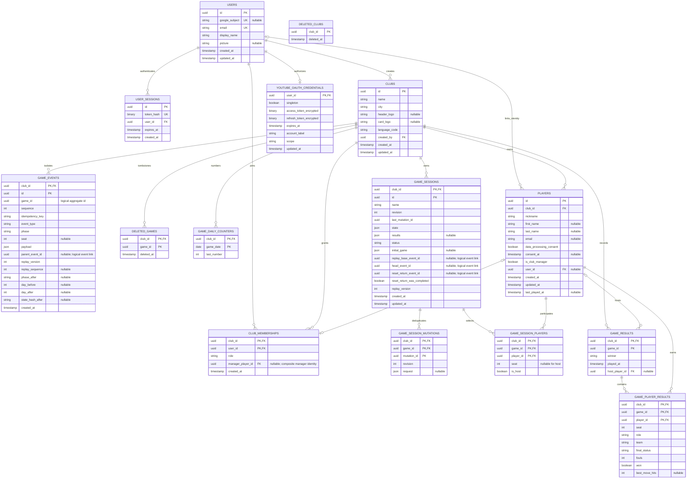
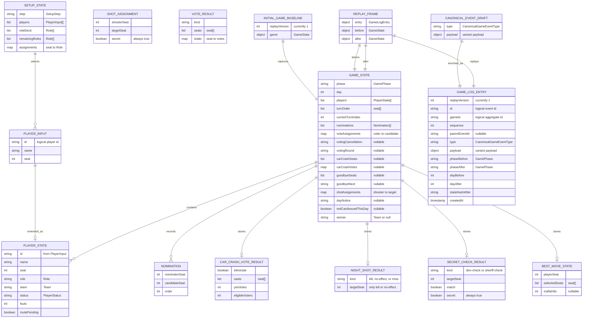

# Entity model

This document describes the current PostgreSQL persistence model and the core game-domain model. It is derived from:

- [`apps/server/src/schema.sql`](../apps/server/src/schema.sql) for physical tables, keys, and foreign keys;
- [`packages/game-domain/src/types.ts`](../packages/game-domain/src/types.ts) for game state;
- [`packages/game-domain/src/game-events.ts`](../packages/game-domain/src/game-events.ts) for canonical events and replay metadata;
- [`apps/server/src/game-session-store.ts`](../apps/server/src/game-session-store.ts) and [`apps/server/src/event-store.ts`](../apps/server/src/event-store.ts) for persistence mappings.

The first diagram is physical: `PK` and `FK` reflect PostgreSQL constraints. The later diagrams are conceptual TypeScript models; their relationships describe containment, extension, or event payloads rather than database foreign keys. `o|`, `||`, and `o{` mean zero-or-one, exactly one, and zero-or-many respectively.

## PostgreSQL entities

### Physical-key notes

- Club isolation is part of the composite keys and composite foreign keys for sessions, mutations, selected players, results, and player results. A matching `club_id` is therefore required across those relationships.
- `club_memberships.manager_player_id`, `club_id`, and `user_id` form a nullable composite foreign key to the manager player's `(id, club_id, user_id)` identity. The partial unique index on `manager_player_id` limits a manager player to at most one membership.
- `game_events` is an event store for both session and non-session game aggregates. `game_events.game_id` deliberately has no foreign key to `game_sessions`.
- `game_events.parent_event_id` and the three event IDs on `game_sessions` are logical replay links. Their former foreign keys are explicitly removed by the schema so retained branches and non-session aggregates remain valid.
- `deleted_games.game_id` and `game_results.game_id` also identify game aggregates without foreign keys to `game_sessions`; only their club and downstream result relationships are physically enforced.
- `deleted_clubs` is an independent deletion marker, not a child of `clubs`; it must survive after the club row is gone. `deleted_games` remains physically scoped to an existing club.
- Important composite uniqueness rules not expressible as single-column `UK` markers include event sequence and idempotency per club/game, replay sequence per club/game, session mutation revision per club/game, and seat per club/game.

## Core game-domain entities

These entities are framework-independent TypeScript values. They are not additional SQL tables, and their identifiers are logical game/player/event identifiers rather than independent database constraints.

`Role`, `Team`, `SetupStep`, `PlayerStatus`, `GamePhase`, and `Winner` are discriminated scalar unions, so they appear as field types rather than fake entities. `votingCancellation` and `votingRound` are inline optional state variants. `VoteResult` and `ShotAssignment` are canonical event payload values; they are connected to their event variants below rather than stored directly in `GameState`.

## Canonical game events

A `CanonicalGameEventDraft` has exactly one of the following 18 variants. Mermaid ER has no XOR connector, so the optional variant edges below collectively mean “exactly one,” not 18 independent optional children.

```mermaid
erDiagram
    CANONICAL_EVENT_DRAFT {
        string type "exactly one canonical type"
        object payload
    }

    GAME_STARTED {
        string eventType "game.started"
        boolean secret "true"
    }

    GAME_CHECKPOINTED {
        string eventType "game.checkpointed"
        boolean secret "true"
    }

    PHASE_CHANGED {
        string eventType "phase.changed"
        string to "GamePhase"
        boolean secret "false"
    }

    TURN_COMPLETED {
        string eventType "turn.completed"
        int seat
        boolean secret "false"
    }

    PLAYER_NOMINATED {
        string eventType "player.nominated"
        int nominatorSeat
        int candidateSeat
        boolean secret "false"
    }

    FOUL_ISSUED {
        string eventType "foul.issued"
        int seat
        int foulNumber
        boolean redCarded
        string phase "optional with turn index"
        int currentTurnIndex "optional with phase"
        boolean secret "false"
    }

    PLAYER_RED_CARDED {
        string eventType "player.red-carded"
        int seat
        string phase "optional with turn index"
        int currentTurnIndex "optional with phase"
        boolean secret "false"
    }

    VOTING_SKIPPED {
        string eventType "voting.skipped"
        string reason "host-skipped"
        boolean secret "false"
    }

    VOTING_RESOLVED {
        string eventType "voting.resolved"
        map voteAssignments "voter to candidate"
        object result "VoteResult"
        boolean secret "false"
    }

    CAR_CRASH_RESOLVED {
        string eventType "car-crash.resolved"
        map votes "seat to boolean"
        object result "CarCrashVoteResult"
        boolean secret "false"
    }

    CAR_CRASH_BALLOT_RESOLVED {
        string eventType "car-crash.ballot-resolved"
        map votes "seat to boolean"
        object result "CarCrashVoteResult"
        boolean secret "false"
    }

    MAFIA_SHOTS_RESOLVED {
        string eventType "mafia.shots-resolved"
        list shots "ShotAssignment[]"
        object result "NightShotResult"
        boolean secret "true"
    }

    DON_CHECKED {
        string eventType "don.checked"
        int targetSeat
        boolean match
        boolean secret "true"
    }

    DON_CHECK_SKIPPED {
        string eventType "don.check-skipped"
        boolean secret "true"
    }

    SHERIFF_CHECKED {
        string eventType "sheriff.checked"
        int targetSeat
        boolean match
        boolean secret "true"
    }

    SHERIFF_CHECK_SKIPPED {
        string eventType "sheriff.check-skipped"
        boolean secret "true"
    }

    BEST_MOVE_COMPLETED {
        string eventType "best-move.completed"
        int playerSeat
        list selectedSeats "seat[]"
        int mafiaHits
        boolean secret "true"
    }

    GAME_COMPLETED {
        string eventType "game.completed"
        string winner "red or black"
        boolean secret "false"
    }

    VOTE_RESULT {
        string kind
        list seats
        map totals
    }

    CAR_CRASH_VOTE_RESULT {
        boolean eliminate
        list seats
        int yesVotes
        int eligibleVoters
    }

    SHOT_ASSIGNMENT {
        int shooterSeat
        int targetSeat
        boolean secret
    }

    NIGHT_SHOT_RESULT {
        string kind
        int targetSeat "conditional"
    }

    CANONICAL_EVENT_DRAFT ||--o| GAME_STARTED : variant
    CANONICAL_EVENT_DRAFT ||--o| GAME_CHECKPOINTED : variant
    CANONICAL_EVENT_DRAFT ||--o| PHASE_CHANGED : variant
    CANONICAL_EVENT_DRAFT ||--o| TURN_COMPLETED : variant
    CANONICAL_EVENT_DRAFT ||--o| PLAYER_NOMINATED : variant
    CANONICAL_EVENT_DRAFT ||--o| FOUL_ISSUED : variant
    CANONICAL_EVENT_DRAFT ||--o| PLAYER_RED_CARDED : variant
    CANONICAL_EVENT_DRAFT ||--o| VOTING_SKIPPED : variant
    CANONICAL_EVENT_DRAFT ||--o| VOTING_RESOLVED : variant
    CANONICAL_EVENT_DRAFT ||--o| CAR_CRASH_RESOLVED : variant
    CANONICAL_EVENT_DRAFT ||--o| CAR_CRASH_BALLOT_RESOLVED : variant
    CANONICAL_EVENT_DRAFT ||--o| MAFIA_SHOTS_RESOLVED : variant
    CANONICAL_EVENT_DRAFT ||--o| DON_CHECKED : variant
    CANONICAL_EVENT_DRAFT ||--o| DON_CHECK_SKIPPED : variant
    CANONICAL_EVENT_DRAFT ||--o| SHERIFF_CHECKED : variant
    CANONICAL_EVENT_DRAFT ||--o| SHERIFF_CHECK_SKIPPED : variant
    CANONICAL_EVENT_DRAFT ||--o| BEST_MOVE_COMPLETED : variant
    CANONICAL_EVENT_DRAFT ||--o| GAME_COMPLETED : variant

    VOTING_RESOLVED ||--|| VOTE_RESULT : includes
    CAR_CRASH_RESOLVED ||--|| CAR_CRASH_VOTE_RESULT : includes
    CAR_CRASH_BALLOT_RESOLVED ||--|| CAR_CRASH_VOTE_RESULT : includes
    MAFIA_SHOTS_RESOLVED ||--|{ SHOT_ASSIGNMENT : includes
    MAFIA_SHOTS_RESOLVED ||--|| NIGHT_SHOT_RESULT : includes
```

| Event type                  | Payload                                                           | Visibility |
| --------------------------- | ----------------------------------------------------------------- | ---------- |
| `game.started`              | Empty                                                             | Secret     |
| `game.checkpointed`         | Empty                                                             | Secret     |
| `phase.changed`             | Destination phase                                                 | Public     |
| `turn.completed`            | Seat                                                              | Public     |
| `player.nominated`          | Nominator and candidate seats                                     | Public     |
| `foul.issued`               | Seat, foul number, red-card flag, and optional discipline context | Public     |
| `player.red-carded`         | Seat and optional discipline context                              | Public     |
| `voting.skipped`            | Host-skipped reason                                               | Public     |
| `voting.resolved`           | Vote assignments and `VoteResult`                                 | Public     |
| `car-crash.resolved`        | Votes and `CarCrashVoteResult`                                    | Public     |
| `car-crash.ballot-resolved` | Votes and `CarCrashVoteResult`                                    | Public     |
| `mafia.shots-resolved`      | Secret shot assignments and `NightShotResult`                     | Secret     |
| `don.checked`               | Target seat and match result                                      | Secret     |
| `don.check-skipped`         | Empty                                                             | Secret     |
| `sheriff.checked`           | Target seat and match result                                      | Secret     |
| `sheriff.check-skipped`     | Empty                                                             | Secret     |
| `best-move.completed`       | Player seat, selected seats, and Mafia hit count                  | Secret     |
| `game.completed`            | Winning team                                                      | Public     |

Provisional interactions such as individual vote assignment/removal, voting candidate advancement, car-crash vote assignment, Mafia shot recording, and `setup.*`, `timer.*`, or `music.*` events are not canonical durable game events.

## Persistence-to-domain mapping

| Persistence field(s)                                                                      | Domain meaning                                                                                                                                                                    |
| ----------------------------------------------------------------------------------------- | --------------------------------------------------------------------------------------------------------------------------------------------------------------------------------- |
| `game_sessions.state`                                                                     | Revisioned `StoredGameSessionState`; contains setup metadata, the current `GameState`, selected host/playlist data, compatibility log data, and hydrated replay metadata.         |
| `game_sessions.initial_game`                                                              | The immutable `InitialGameBaseline` used as the replay starting state.                                                                                                            |
| `game_sessions.results`                                                                   | Completed-game projection used to materialize `game_results` and `game_player_results`.                                                                                           |
| `game_events.event_type` + `game_events.payload`                                          | Event discriminator and variant payload. Rows with complete replay metadata hydrate as `GameLogEntry`; the event store can also hold non-session or provisional aggregate events. |
| `game_events.parent_event_id`                                                             | Logical parent link for retained replay branches.                                                                                                                                 |
| `game_events.replay_sequence`, phase/day fields, `replay_version`, and `state_hash_after` | Canonical ordering and deterministic replay-integrity metadata.                                                                                                                   |
| `game_sessions.state`                                                                     | Authoritative full browser snapshot, including current `GameState`, semantic event prefix, and Undo allowance.                                                                    |
| `game_sessions.replay_base_event_id`                                                      | Compatibility mirror of the snapshot's semantic-history root.                                                                                                                     |
| `game_sessions.head_event_id`                                                             | Compatibility mirror of the snapshot's retained semantic-history head; it does not override `state.game`.                                                                         |
| `game_sessions.reset_return_event_id`                                                     | Retired compatibility column; browser-authoritative snapshots keep it null and expose no Reset Return.                                                                            |

PostgreSQL mirrors the last uploaded valid browser snapshot and its exact semantic event prefix. Domain replay follows the retained parent chain to validate phase/day transitions and hashes for Log/Timeline integrity, but the snapshot's `state.game` remains the current gameplay authority.
